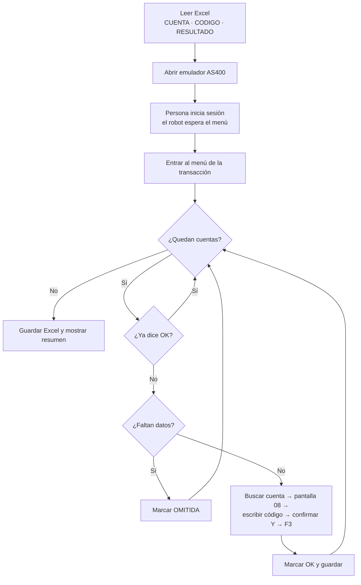

# 🤖 Automatización RPA con Power Automate Desktop

Ejemplos de mis flujos de **Power Automate Desktop (PAD)**. He creado **más de 100 flujos** de RPA para automatizar trabajo repetitivo de operaciones y **1 flujo en Power Automate Cloud**.

> *RPA portfolio: Power Automate Desktop flows that replace manual, repetitive data entry in legacy systems (AS400 / IBM i) using Excel as input.*

⚠️ **Versión de portafolio:** las rutas, los menús, los títulos de pantalla y los datos son de ejemplo. El flujo real se usa en un entorno de trabajo y **no se publica ningún dato de la empresa**.

---

## Flujo destacado: actualización masiva en AS400 desde Excel

### El problema
Había que entrar a un sistema **AS400 (IBM i)** y cambiar un código **cuenta por cuenta**: buscar la cuenta, abrir la pantalla correcta, escribir el código, confirmar y volver. Con listas largas es lento y es fácil equivocarse de fila.

### La solución
Un robot que lee la lista desde **Excel** y hace esos pasos en el emulador de terminal por cada cuenta. Al terminar, escribe el resultado en el mismo Excel para que quede **evidencia** de lo que se actualizó.

📄 Código del flujo: [`flujos/actualizacion_masiva_as400.txt`](flujos/actualizacion_masiva_as400.txt)  
✅ Validado en Power Automate Desktop: el texto se pega en un flujo nuevo y carga sus 82 acciones sin errores.  
📊 Plantilla de Excel de ejemplo: [`datos_ejemplo/plantilla_actualizacion.xlsx`](datos_ejemplo/plantilla_actualizacion.xlsx)

### Qué mejoré respecto a la primera versión

| Antes | Ahora |
|---|---|
| Rutas escritas dentro de cada acción | Todo en una sección de **configuración** al inicio |
| `WAIT 18` fijo para esperar el emulador | Espera la **ventana** y el **texto del menú**, con tiempo límite |
| Escribía en la pantalla sin comprobar dónde estaba | Confirma que está en la **pantalla correcta** antes de escribir |
| Si una fila venía vacía, igual la enviaba | **Valida** cuenta y código; si faltan, marca la fila como *OMITIDA* |
| No quedaba registro de lo hecho | Escribe **OK** en la columna RESULTADO y **guarda** después de cada cuenta |
| Si se detenía, había que revisar a mano dónde quedó | Se puede **volver a ejecutar**: salta las filas que ya dicen OK |
| Acciones viejas desactivadas dentro del flujo | Flujo limpio y **comentado** por secciones |
| Terminaba sin avisar | Muestra un **resumen**: actualizadas, omitidas y ya hechas |

### Seguridad
- El flujo **no guarda usuario ni contraseña**. La persona inicia sesión en el emulador y el robot espera.
- El Excel es la única entrada, y la columna RESULTADO deja la evidencia de cada cambio.

---

## Cómo probarlo
Ver la [guía de uso](docs/GUIA_DE_USO.md).

## Habilidades que muestra
- RPA con **Power Automate Desktop**: emulación de terminal (HLLAPI), Excel, variables, bucles y condiciones
- Automatización de **sistemas legados (AS400 / IBM i)**
- Diseño de procesos **seguros y re-ejecutables**, con evidencia de cada cambio

---

**Autor:** Elius Mendez · [LinkedIn](https://www.linkedin.com/in/elius-mendez-ramirez-09189a140/) · Licencia [MIT](LICENSE)
